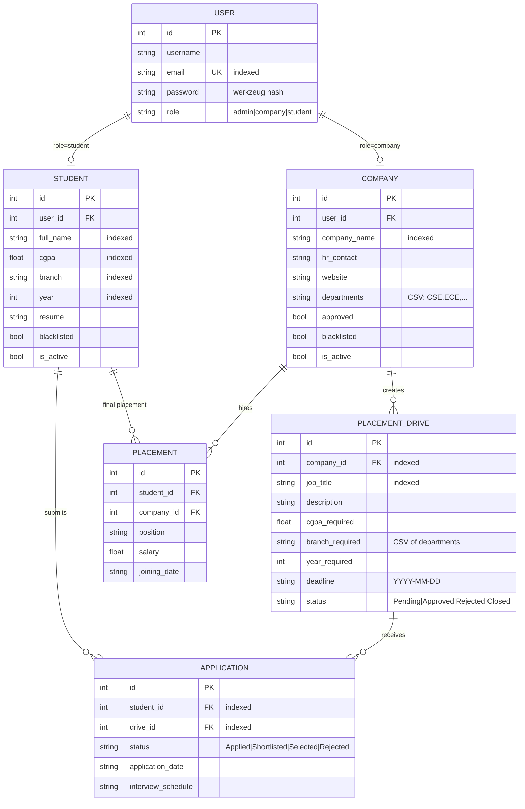

# 🎓 Placement Portal

A full-stack placement portal built with **Flask** (backend) and **Vue 3 + Vite** (frontend), using **SQLite** for storage, **Redis + Celery** for async jobs, and **JWT** for authentication.

Three roles: **Admin · Company · Student**

- **Admin** — approves/rejects companies and drives, blacklists users, searches students/companies, views placement statistics, exports data (with optional email delivery).
- **Company** — registers (pending admin approval), creates placement drives with multi-department eligibility, manages applicants (shortlist / schedule interview / select / reject).
- **Student** — registers, browses approved drives with filters, applies (server-side eligibility checks), tracks application status, exports application history as CSV.

---

## 📁 Project Structure

```
Placement_Portal_Application_V2/
├── backend/
│   ├── app.py              # Flask API: models, auth (JWT), all routes, admin seed
│   ├── config.py           # Dev/prod configuration (env-driven)
│   ├── celery_app.py       # Celery instance + beat schedule (Jobs A & B)
│   ├── tasks.py            # Celery tasks: CSV exports, reminders, monthly report, SMTP email
│   ├── requirements.txt    # Python dependencies
│   ├── .env.example        # Environment variable template
│   ├── pytest.ini          # Test configuration
│   ├── tests/              # pytest suite (models, auth, business logic, jobs)
│   ├── instance/           # SQLite database (auto-created, git-ignored)
│   ├── uploads/            # Student resumes (git-ignored)
│   └── exports/            # Generated CSV/HTML exports (git-ignored)
└── frontend/
    └── src/
        ├── App.vue                  # Role-based routing + JWT handling
        └── components/
            ├── LoginView.vue        # Unified login + role redirect
            ├── StudentRegister.vue  # Student registration
            ├── CompanyRegister.vue  # Company registration (departments, HR contact)
            ├── StudentDashboard.vue # Drives + filters, apply, profile, resume, export
            ├── CompanyDashboard.vue # Drive creation, applicant management
            └── AdminDashboard.vue   # Management, search, stats, export + email
```

---

## 🚀 Setup & Installation

### Prerequisites

- Python 3.10+
- Node.js 18+
- (Optional) Redis — required only for async exports and scheduled jobs; the app degrades gracefully without it

### 1. Backend

```bash
cd backend
python3 -m venv venv
source venv/bin/activate
pip install -r requirements.txt

# Configure environment
cp .env.example .env
# edit .env — at minimum set JWT_SECRET and SMTP credentials

# Run the API (auto-creates the SQLite DB and seeds the admin user)
python app.py
# → http://127.0.0.1:8000
```

### 2. Frontend

```bash
cd frontend
npm install
npm run dev
# → http://localhost:5173
```

### 3. Seeding the Admin User

The admin account is created **programmatically on first boot** — there is intentionally **no admin registration UI or endpoint**. Credentials come from `.env`:

```
ADMIN_EMAIL=admin@placement.local
ADMIN_USERNAME=admin
ADMIN_PASSWORD=admin
```

To re-seed, delete `backend/instance/placement.db` and restart the backend.

---

## ⚙️ Background Jobs (Celery + Redis)

Start Redis, then a worker and the beat scheduler from `backend/` (with the venv active):

```bash
redis-server &                                  # broker + result backend

# Worker — runs Job C (async CSV export) and any queued tasks
celery -A celery_app.celery worker --loglevel=info

# Beat — schedules Job A (daily 9:00 AM) and Job B (1st of month, 8:00 AM)
celery -A celery_app.celery beat --loglevel=info
```

| Job | Trigger | What it does |
|-----|---------|--------------|
| **A — Deadline reminders** | Daily @ 9:00 AM (Asia/Kolkata) | Emails students who haven't applied to an approved drive whose deadline is within `REMINDER_DAYS` (default 2) |
| **B — Monthly report** | 1st of month @ 8:00 AM | Builds an HTML stats report (drives, applicants, selected) and emails it to `ADMIN_EMAIL` |
| **C — CSV export** | User-triggered | Student application history / admin data exports. Falls back to **synchronous generation** when Redis is unavailable, so the feature always works |

---

## 🔐 Environment Variables

Copy `backend/.env.example` → `backend/.env`. All variables are optional (sane defaults apply), but SMTP must be configured for email features.

| Variable | Default | Purpose |
|----------|---------|---------|
| `FLASK_ENV` | `development` | `development` (debug on) or `production` |
| `DATABASE_URL` | `sqlite:///placement.db` | Any SQLAlchemy URI (PostgreSQL-ready) |
| `REDIS_URL` | `redis://localhost:6379/0` | Celery broker/backend + cache |
| `SECRET_KEY` | dev placeholder | Flask secret |
| `JWT_SECRET` | dev placeholder | **Change in production** — signs auth tokens |
| `JWT_EXPIRY_HOURS` | `12` | Token lifetime |
| `SMTP_HOST` | `smtp.gmail.com` | SMTP server |
| `SMTP_PORT` | `587` | SMTP port (STARTTLS) |
| `SMTP_USER` | — | SMTP login (for Gmail: your address + app password) |
| `SMTP_PASSWORD` | — | SMTP password / app password |
| `MAIL_FROM` | `SMTP_USER` | Sender address |
| `ADMIN_EMAIL` | `admin@placement.local` | Seeded admin login + monthly report recipient |
| `ADMIN_USERNAME` | `admin` | Seeded admin username |
| `ADMIN_PASSWORD` | `admin` | Seeded admin password |
| `REMINDER_DAYS` | `2` | Deadline-reminder window (Job A) |

> **Gmail note:** enable 2FA and use an [App Password](https://myaccount.google.com/apppasswords) for `SMTP_PASSWORD`.

---

## 🗃️ Database Schema



`APPLICATION` has a **unique constraint on (student_id, drive_id)** — duplicate applications are impossible at the DB level as well as in application logic.

---

## 🔒 Business Rules (enforced server-side)

- Students can apply only to **Approved** drives, before the **deadline**, once per drive.
- Eligibility checked on apply: **CGPA ≥ cutoff**, **branch ∈ drive departments**, **year match**.
- Companies must be **approved by admin** before creating drives; drives start as **Pending**.
- **Blacklisted** students/companies cannot log in or apply.
- Admins are seed-only — no registration route exists.
- Passwords are hashed with **werkzeug (scrypt)**; legacy plaintext passwords are transparently upgraded on first successful login.
- All role-protected endpoints require a **JWT** (`Authorization: Bearer <token>`); wrong role → `403`, missing/invalid token → `401`.

---

## 🧪 Testing

```bash
cd backend
source venv/bin/activate
pytest -v
```

The suite (42 tests) runs against a **throwaway SQLite database** and covers:

- `tests/test_models.py` — fields, relationships, unique constraints
- `tests/test_auth.py` — hashing, JWT, role enforcement, blacklist blocking
- `tests/test_business_logic.py` — eligibility, duplicates, deadlines, drive workflow, search filters, stats
- `tests/test_jobs.py` — CSV builders, SMTP fallback, reminder + monthly-report jobs

---

## 📡 API Overview

| Method | Endpoint | Access | Purpose |
|--------|----------|--------|---------|
| POST | `/login` | public | Unified login → JWT + role |
| POST | `/student/register`, `/company/register` | public | Registration |
| GET | `/departments` | public | Canonical department list |
| GET/PUT | `/student/profile/<id>` | student | View/edit profile |
| POST | `/student/resume/<id>` | student | Upload resume |
| GET | `/drives` | public | Drives (`?approved_only`, `?q`, `?branch`, `?max_cgpa`, `?deadline_before`) |
| POST | `/apply` | student | Apply with eligibility checks |
| GET | `/student/history/<id>` | student | Application history |
| POST | `/export/applications/<id>` | student | CSV export (async or sync fallback) |
| POST | `/drive/create` | company | Create drive (multi-department) |
| PUT | `/application/update/<id>`, `/application/schedule/<id>` | company | Shortlist/select/reject, schedule interview |
| GET | `/admin/dashboard`, `/admin/stats` | admin | Counts + placement statistics |
| GET | `/admin/search/students` | admin | `?q`, `?branch`, `?year`, `?min_cgpa`, `?max_cgpa` |
| GET | `/admin/search/companies` | admin | `?q`, `?department` |
| PUT | `/admin/company/approve|reject|blacklist/<id>` | admin | Company management |
| PUT | `/admin/student/blacklist/<id>` | admin | Student management |
| PUT | `/admin/drive/approve|reject/<id>` | admin | Drive management |
| POST | `/admin/export` | admin | Export students/companies/applications (+ optional email) |
| GET | `/exports/<filename>` | public | Download generated export |

---

## ⚡ Caching

Flask-Caching with **Redis** when available, in-memory otherwise. Cached: approved drive lists, admin dashboard/stats, search results (60s TTL, query-string aware). Cache is invalidated on every mutation (drive approval, new application, blacklist, etc.). Database indexes cover the hot query paths (student branch/cgpa/year, drive status/company, application student/drive/status).
